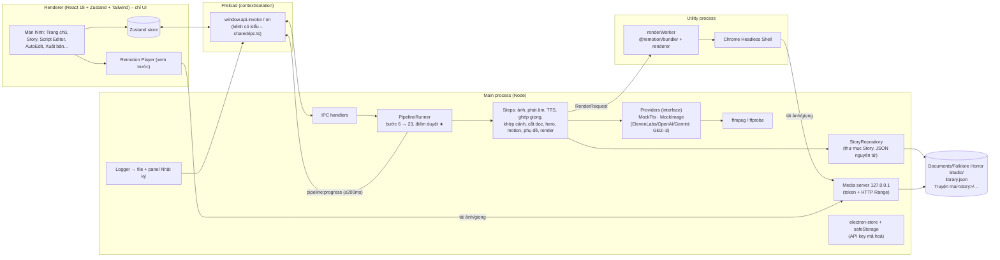

# Folklore Horror Studio – Giai đoạn 1–5

Ứng dụng desktop (Windows 10/11) sản xuất video kể chuyện kinh dị dân gian Việt Nam & Đông Nam Á.
Mô hình cốt lõi: **một Story → nhiều Release** (YouTube EN 16:9, TikTok VI 9:16, …).

GĐ1 chạy **hoàn toàn offline, không tốn phí**: giọng Mock (ffmpeg), ảnh placeholder (sharp), render MP4 thật bằng Remotion.

---

## 1. Sơ đồ kiến trúc



Cùng một hàm `buildCompositionProps()` (src/shared/composition.ts) dựng props cho **Player** và cho **render** ⇒ xem trước khớp với video xuất ra; cùng một composition render được cả 16:9 lẫn 9:16.

## 2. Cây thư mục

```
YTB/
├─ package.json · electron.vite.config.ts · tsconfig*.json · tailwind/postcss · vitest*.config.ts
├─ src/
│  ├─ config/                 # KHÔNG hardcode: model, giá, rate limit, audio tag, preset nền tảng
│  │  ├─ providers.json
│  │  └─ platforms.json
│  ├─ shared/                 # dùng chung main/renderer/Remotion (không import Node/Electron)
│  │  ├─ types.ts             # DATA MODEL – nguồn sự thật duy nhất
│  │  ├─ ipc.ts               # IPC có kiểu (IpcInvokeMap / IpcEventMap)
│  │  ├─ pipeline.ts          # định nghĩa bước 6–23, điểm duyệt ★
│  │  ├─ composition.ts       # props composition + buildCompositionProps()
│  │  ├─ sampleData.ts        # Story ma da, 7 beat, 13 cảnh, 2 Release
│  │  ├─ config.ts · media.ts
│  │  └─ logic/               # hàm thuần, có unit test
│  │     ├─ pronunciation.ts  speech.ts  timeline.ts  sceneMatching.ts
│  │     └─ motion.ts  hero.ts  focusCrop.ts  subtitles.ts  kenBurns.ts
│  ├─ main/
│  │  ├─ index.ts · ipc.ts · settings.ts · logger.ts · errors.ts · progressEmitter.ts
│  │  ├─ storage/storyRepo.ts
│  │  ├─ media/  ffmpeg.ts  wav.ts  verticalFrame.ts  mediaServer.ts
│  │  ├─ providers/ interfaces.ts  stubs.ts  mock/{mockTts,mockImage}.ts
│  │  ├─ pipeline/ context.ts  runner.ts  steps.ts
│  │  └─ render/  protocol.ts  renderCore.ts  renderWorker.ts  renderService.ts
│  ├─ preload/  index.ts  index.d.ts
│  ├─ remotion/ index.ts  Root.tsx  FolkloreVideo.tsx  SceneLayer.tsx  SubtitleLayer.tsx  Overlays.tsx
│  └─ renderer/
│     ├─ index.html
│     └─ src/ main.tsx App.tsx index.css
│        ├─ store/appStore.ts · lib/{format,preview}.ts
│        ├─ components/ Sidebar TopBar StatusBar LogPanel Icon ui
│        └─ screens/ Home Story ScriptEditor AutoEdit(+autoedit/*) Library Placeholder Publish Settings
└─ tests/  *.test.ts (unit) · smoke/pipeline.smoke.test.ts (render MP4 thật)
```

Dữ liệu người dùng (tự tạo lần đầu):

```
Documents/Folklore Horror Studio/
├─ library.json                       # kênh, truyền thuyết, nhân vật, giọng, từ điển phát âm
└─ Truyện ma/story-ma-da-ben-cay-da/  # (tên thư mục có dấu + khoảng trắng – cố ý để kiểm thử)
   ├─ story.json · bank/ · cache/
   └─ releases/<releaseId>/release.json · sources.json · voice/ · sfx/ · exports/*.mp4
```

## 3. Lý do các quyết định chính

- **Pipeline không import Electron** (nhận `PipelineDeps`): cùng code chạy trong app và trong smoke test – nhờ vậy đã kiểm chứng render MP4 thật mà không cần mở UI.
- **Render trong utility process**, giữ sống để tái dùng bundle Remotion: webpack + Chrome + mã hoá video không làm đứng UI; huỷ được bằng `makeCancelSignal`.
- **Media server HTTP nội bộ** (127.0.0.1, cổng ngẫu nhiên, token bí mật, hỗ trợ Range) thay cho `file://`: Player và Chrome headless dùng chung một URL, encode từng đoạn nên đường dẫn có dấu tiếng Việt vẫn chạy.
- **Ghép giọng bằng cách đặt từng câu theo mẫu (sample) trên nền im lặng** (`placeClips`): mốc start/end trong JSON khớp tuyệt đối với file WAV – nền móng cho phụ đề và khớp cảnh chính xác.
- **Logic thuần trong `shared/logic`** (khớp cảnh, đa dạng, hero, cắt dọc, phụ đề, Ken Burns): dễ unit test, dùng chung cho Player và render.
- **Trạng thái pipeline lưu trong release.json** sau mỗi bước: tắt app mở lại vẫn ở đúng điểm duyệt; bước lỗi chạy lại riêng; cache theo hash (take giọng) / file tồn tại (ảnh) nên chạy lại không tạo trùng.
- **IPC có kiểu một chỗ** (`IpcInvokeMap`): thêm kênh ⇒ TypeScript bắt main và renderer phải khớp; preload chỉ cho phép danh sách kênh khai báo; API key không bao giờ sang renderer.
- **Ghi JSON nguyên tử** (ghi `.tmp` rồi rename, khoá theo file, thử lại khi Windows khoá file) để không hỏng dữ liệu khi crash.
- **Thêm thư viện ngoài danh sách**: chỉ **vitest** (chạy test TypeScript trực tiếp, cùng hệ Vite). p-queue dùng bản 6 (CommonJS) và được bundle vào main để tránh lỗi interop.
- **Model mở rộng tối thiểu so với đặc tả** (để dùng được thực tế): `Release.title`, `Take.id/hash/model`, `PronunciationEntry.glossEn` (thuật ngữ cần thẻ chú thích), `SceneBankItem.needsVerticalVersion`, `Story.fictionNoteVi` + `performanceNotes`, `PipelineState`.

## 4. Cài đặt & chạy

Yêu cầu: Windows 10/11, Node.js ≥ 20 (đã thử với Node 24), kết nối mạng ở lần cài đầu.

```bash
npm install          # cài thư viện (kèm ffmpeg, ffprobe, Electron)
npm run dev          # mở app ở chế độ phát triển
```

Lệnh khác:

```bash
npm test             # 33 unit test (logic thuần)
npm run typecheck    # kiểm tra kiểu cả main lẫn renderer
npm run smoke        # chạy TOÀN BỘ pipeline cho 2 Release + render 2 MP4 (bản 50%) vào .smoke-output/
npm run build        # build vào out/
```

> Lần render đầu tiên, Remotion tự tải **Chrome Headless Shell** (~100 MB) – cần mạng, chỉ một lần.
> Remotion miễn phí cho cá nhân/công ty ≤ 3 người; khi công ty lớn hơn cần mua giấy phép Remotion.

## 5. Checklist kiểm tra thủ công GĐ1

1. `npm run dev` → cửa sổ tối (≥1280×800), thanh icon trái, thanh trạng thái hiện "Chế độ Mock".
2. Trang chủ thấy Story **"Ma da ở bến cây đa"** với 2 Release (EN·YouTube·16:9, VI·TikTok·9:16).
3. Màn **Story**: dàn ý 7 beat song ngữ + thanh cường độ; ghi chú thật/hư cấu; ngân hàng 13 cảnh (ảnh xuất hiện sau bước 6) có chấm focusPoint.
4. Màn **Script Editor**, chọn Release EN: hai cột Anh | Việt, thuật ngữ *ma da*, *cây đa*, *đò* in nghiêng; chip delivery; thanh bên có section/beat/ước tính thời lượng. Chọn Release VI: một cột.
5. Màn **AutoEdit**, chọn Release TikTok, chế độ "Duyệt từng bước", bấm **Bắt đầu**:
   - dừng ở `BƯỚC 7/23: Duyệt storyboard ★` → bấm **Tiếp tục** → dừng ở 9 → 13 → 20;
   - tại bước 20: Player phát được video 9:16 có tiếng, ảnh chuyển động, phụ đề chữ to highlight từng từ, nhãn "Phần 1/1"; timeline có track Video/Voice/Subtitle, click cảnh để tua và xem thuộc tính bên phải; đổi kiểu chuyển động → Lưu cảnh → Player cập nhật;
   - bấm **Tiếp tục** → bước 21 hiện % render, thời gian đã chạy, ước tính còn lại.
6. Lặp lại với Release YouTube EN (thử "Full Auto – bản nháp"): phụ đề nền mờ, thuật ngữ in nghiêng màu vàng, thẻ chú thích góc trái khi thuật ngữ xuất hiện lần đầu.
7. Màn **Xuất bản**: thấy 2 file MP4 → **Mở** phát được trong trình phát Windows; **Mở thư mục** thấy `sources.json` bên cạnh.
8. Bấm **Huỷ** khi đang render → bước 21 chuyển "Đã huỷ"; bấm "Chạy lại bước 21" để tiếp tục. Đóng app khi đang chờ duyệt → mở lại vẫn ở đúng bước.
9. Nút **Nhật ký** ở góc phải dưới: log từng bước, cảnh báo thiếu cảnh, cảnh báo giấy phép giọng.
10. Màn Thư viện dân gian, Kênh & Nhân vật hiển thị dữ liệu; Voice Studio, Film Studio, Storyboard hiện nhãn "Giai đoạn X".

## 6. Giai đoạn 2 – Kịch bản, giọng, nhân vật

### Đã có
| Phần | Nội dung |
|---|---|
| Chế độ Mock / API thật | Cài đặt → công tắc **Chế độ Mock**. Bật: LLM + giọng giả lập, không tốn phí. Tắt: LLM = OpenAI, giọng theo provider của từng VoiceProfile (mock / ElevenLabs v3 / OpenAI gpt-4o-mini-tts). API key nhập ở Cài đặt (mã hoá safeStorage). |
| Story (bước 1–4) | Tạo Story → LLM dàn ý song ngữ → sửa / ★ duyệt → LLM đề xuất dàn nhân vật (3a, tự gợi ý giọng) → LLM đề xuất ngân hàng cảnh (có `cast`, 2 cảnh người kể). Mọi nút LLM hiện ước tính chi phí; vượt ngân sách Story thì chặn. |
| Chuyển thể (bước 8) | Mỗi Release được LLM **viết lại** theo ngôn ngữ/nền tảng/độ dài; câu thoại nhân vật xen lời kể; người kể (nhân vật kênh) dẫn bối cảnh/giải thích/kết. TikTok/Shorts: viết cả truyện → **tự chia phần** theo thời lượng (ưu tiên ranh giới beat) → LLM viết móc mở đầu + câu treo từng phần → tạo các Release "Phần k/N". |
| Script Editor | Sửa người nói, lời, bản dịch, tag/chỉ dẫn/nhịp/khoảng lặng; thêm/xoá/đổi thứ tự câu; **viết lại một câu bằng LLM**; chuyển thể lại; ★ duyệt kịch bản. Lưu ⇒ pipeline chạy lại từ bước 10, câu không đổi giữ take cũ (cache theo hash). |
| Voice Studio | Gán giọng theo người nói, preset xử lý giọng, ô "Đã xác nhận giấy phép thương mại", waveform, chọn take, nghe **gốc / sau xử lý**, sửa tag–nhịp–lặng rồi **tạo lại từng câu**, ★ duyệt giọng. |
| Nhân vật & Giọng | Tab Nhân vật truyện / Nhân vật kênh / Giọng / Kênh: ngoại hình, trang phục, trạng thái, biểu cảm, khoá, giọng EN/VI có Nghe thử; hồ sơ giọng (provider, voice id, chỉ dẫn, tốc độ, xử lý). |
| Thư viện dân gian | Thêm/sửa/xoá truyền thuyết; từ điển phát âm theo ngôn ngữ, nghe **gốc** và **đã sửa**. |
| Xử lý giọng | Mỗi câu xử lý theo chuỗi của **giọng nói câu đó** (người kể ấm, ma vọng xa…), ghép chính xác tới từng mẫu. |

### Dùng API thật lần đầu
1. Cài đặt → dán key OpenAI (LLM + OpenAI TTS) và/hoặc ElevenLabs → Lưu → tắt Chế độ Mock.
2. Nhân vật & Giọng → tab Giọng → đổi provider của giọng sang ElevenLabs (dán voice_id) hoặc OpenAI (chọn voice) → Nghe thử → tích "Đã xác nhận giấy phép thương mại" khi đã kiểm tra điều khoản.
3. Model, endpoint, giá tham khảo nằm trong `src/config/providers.json` – **hãy kiểm tra lại giá** trên trang provider.

### Kiểm thử
- `npm test` – 67 unit test (thêm: chia phần TikTok, HTTP retry/429/Retry-After, LLM thử lại khi sai schema, kiểm tra id trong output LLM, payload ElevenLabs/OpenAI, chọn/gợi ý giọng, cảnh người kể, ngân sách, nâng cấp dữ liệu).
- `npm run smoke` – 3 kịch bản end-to-end bằng Mock (TikTok mẫu có câu thoại, YouTube có cảnh người kể, Story mới → TikTok chia 2 phần) và render MP4.
- Kiểm thử UI ẩn (không đụng chuột/màn hình): `npm run build`, rồi chạy Electron với biến môi trường `FHS_UI_SMOKE=<thư mục ảnh>`, `FHS_USER_DATA=<thư mục tạm>`, `FHS_DATA_ROOT=<thư mục dữ liệu>` – app tự mở từng màn, chụp ảnh, ghi `report.json` (lỗi console) rồi thoát.

### Checklist thủ công GĐ2
1. Trang chủ → **+ Tạo Story mới** → nhập ý tưởng → màn Story: **Tạo dàn ý** → sửa một beat → **Lưu** → **★ Duyệt dàn ý**.
2. **Đề xuất nhân vật** → kiểm tra giọng được gợi ý (thực thể dùng giọng thì thầm) → **Đề xuất ngân hàng cảnh** → thẻ cảnh có avatar nhân vật, lọc theo nhân vật.
3. **+ Thêm bản phát hành** → TikTok VI, 2 phần → AutoEdit → Bắt đầu → dừng ★7 → Tiếp tục → bước 8 chuyển thể + chia phần → dừng ★9.
4. Script Editor: thấy "Các phần của series", sửa 1 câu, **Viết lại (LLM)** 1 câu, Lưu → **★ Duyệt kịch bản & tiếp tục**.
5. Voice Studio (khi dừng ★13): câu thoại nhân vật có giọng khác người kể; nghe Gốc / Sau xử lý; đổi nhịp → **Lưu & tạo lại**; **★ Duyệt giọng & tiếp tục** → video.
6. Thư viện dân gian: thêm thuật ngữ, Lưu, nghe **Gốc** và **Đã sửa** khác nhau.
7. Tắt Mock khi chưa có key → bấm Tạo dàn ý → thông báo tiếng Việt "Chưa có API key OpenAI…".

## 7. Giai đoạn 3 – Hình ảnh & nhân vật

### Đã có
| Phần | Nội dung |
|---|---|
| Hàng đợi job (`main/queue/jobQueue.ts`) | 1–20 luồng chỉnh khi đang chạy; giới hạn riêng theo provider (Gemini 10, Mock 20 – trong config); retry backoff + jitter, 429/503 tôn trọng `Retry-After`; huỷ / tạm dừng / tiếp tục / thử lại; **dừng cả hàng đợi khi chạm ngân sách** Story hoặc tháng; ghi chi phí từng ảnh vào sổ của Story; cache theo hash(prompt + model + tham số + ảnh tham chiếu) – không tạo trùng; lưu `queue.json`, mở lại app thì **khôi phục ở trạng thái tạm dừng**. |
| Gemini (Nano Banana) | `@google/genai`, tỉ lệ 16:9 / 9:16 / 1:1, gửi kèm ảnh tham chiếu (thu nhỏ 1024px), timeout, báo rõ khi bị bộ lọc an toàn chặn. Key nhập ở Cài đặt. |
| Prompt ảnh | artStyle + **cultural visual bible** + mô tả cảnh + cỡ cảnh/góc máy + nhân vật (ngoại hình, trang phục, trạng thái, biểu cảm, hành động) + **thực thể** (thiết kế từ FolkloreEntry, chỉ gợi qua bóng tối) + "Avoid: negative prompt". Tối đa 3 nhân vật rõ mặt/cảnh. |
| Nhân vật (3b, 3c) | Character sheet 4 góc (chính diện trước, 3 góc sau dùng chính diện làm tham chiếu), ảnh bảng biểu cảm, ảnh trạng thái ngoại hình. **Khoá** nhân vật ⇒ mọi ảnh cảnh có nhân vật đó gửi kèm ảnh tham chiếu đúng trạng thái + biểu cảm; nhân vật đã khoá không bị tạo lại sheet. |
| Kiểm tra đồng nhất | LLM nhìn ảnh (OpenAI, ảnh gửi dạng detail "low") so ảnh cảnh với character sheet, đánh dấu cảnh lệch (sai trang phục, kiểu tóc…). |
| Film Studio | Thanh trượt luồng 1–20, AUTO (job mới tự chạy), AUTO DL (ảnh mới tự áp vào cảnh / thành biến thể chờ chọn), chế độ Tạo ảnh / Ảnh→Video (GĐ4) / Đồng nhất nhân vật, model, lọc nhân vật, tỷ lệ, tab Thư viện / Hàng chờ, chọn nhiều, tạo lại, **Tải hết (ZIP)** theo độ phân giải. |
| Storyboard | Lưới cảnh, xem nhanh 16:9 / 9:16, **kéo focusPoint**, avatar + lọc theo nhân vật, biến thể (bấm để dùng), huy hiệu đồng nhất, phím tắt **A** duyệt · **R** tạo lại · **E** sửa prompt/cast · **V** tạo bản dọc riêng · ←/→, ★ duyệt storyboard & tiếp tục. |
| Inspector cảnh | Sửa cast (nhân vật, trạng thái, biểu cảm, vị trí, hành động) ở Storyboard (E) và AutoEdit. |
| Kênh | Sửa artStyle, negative prompt, bảng màu, cultural visual bible. |
| Pipeline | Bước 6 tạo ảnh qua hàng đợi (song song, có tiến độ); bước 15 chỉ cắt dọc cho cảnh chưa có ảnh 9:16 vẽ riêng. Mọi job ảnh cập nhật story.json theo kiểu đọc–sửa–ghi nguyên tử. |

### Dùng Gemini thật
Cài đặt → dán key Google Gemini → tắt Chế độ Mock → Film Studio chọn model Gemini. Nên làm theo thứ tự: tạo character sheet → duyệt → **Khoá** → tạo ảnh cảnh. Giá tham khảo trong `src/config/providers.json` (hãy kiểm tra lại).

### Kiểm thử
- `npm test` – 82 unit test (thêm: hàng đợi – số luồng, giới hạn provider, retry/Retry-After, huỷ, tạm dừng, ngân sách, cache, lưu/khôi phục; prompt ảnh; chọn ảnh tham chiếu; adapter Gemini với client giả; ZIP; luồng ImageService đầy đủ bằng Mock).
- Kiểm thử UI ẩn có thêm `FHS_UI_SMOKE_STORY=<storyId>` (chọn Story) và `FHS_UI_SMOKE_GEN=<characterId>,<sceneId>` (tạo character sheet + bản 9:16 qua IPC trước khi chụp).

### Checklist thủ công GĐ3
1. Nhân vật & Giọng → Út Lan → **Tạo character sheet** → Film Studio → Hàng chờ thấy 1 rồi 3 job → 4 ảnh hiện ở thẻ nhân vật → **Ảnh trạng thái** → tích **Khoá** → Lưu.
2. Storyboard → chọn cảnh có Lan (#10) → phím **V** → bản 9:16 mới (placeholder ghi "1–3 ảnh tham chiếu") → xem ở nút 9:16.
3. Kéo focusPoint một cảnh ở chế độ 16:9 → AutoEdit chạy lại từ bước 15 → bản cắt dọc theo điểm mới.
4. Film Studio: kéo số luồng lên 10, tắt AUTO DL → chọn 3 cảnh → **Tạo** → ảnh mới thành biến thể viền vàng ở Storyboard → bấm để dùng.
5. Tắt AUTO → tạo ảnh → job nằm "Chờ" tới khi bấm **Bắt đầu / Tiếp tục**; đóng app khi còn job chờ → mở lại thấy hàng chờ khôi phục ở trạng thái tạm dừng.
6. Đặt ngân sách Story rất nhỏ, tắt Mock, tạo ảnh Gemini → hàng đợi dừng với thông báo "chạm ngân sách".
7. **Kiểm tra đồng nhất** → huy hiệu "đồng nhất ✓" / "⚠ lệch" trên thẻ cảnh. **Tải hết (ZIP)** → mở được bằng Windows Explorer.

## 8. Giai đoạn 4 – Chuyển động & âm thanh

### Đã có
| Phần | Nội dung |
|---|---|
| Mức 2 – Parallax 2.5D | Depth map **local** bằng `onnxruntime-node` (Depth Anything V2 Small, ~27 MB, tải ở Cài đặt; model cấu hình ở `providers.json → depth`) → tách 3 lớp PNG (hậu cảnh đặc, chủ thể, tiền cảnh có alpha; phía sau chủ thể được lấp bằng bản mờ) → mỗi lớp chuyển động khác tốc độ (dolly vào/ra, truck trái/phải). Chưa có model ⇒ depth ước lượng để vẫn chạy. Cache theo ảnh nguồn. |
| Mức 3 – Video AI cảnh hero | `VideoProvider`: **Veo** (image-to-video qua `@google/genai`, dùng chung key Gemini) và **Mock** (ffmpeg: zoom chậm + hạt phim + ánh sáng chập chờn). Bước 16 chọn cảnh hero theo `heroRatio` (ưu tiên hook + cao trào) → **báo giá ★ và chờ Đồng ý / Bỏ qua** khi có phí (Full Auto không tự chi tiền) → tạo qua hàng đợi → lỗi ⇒ quay về Mức 1/2. Composition phát clip rồi chuyển mềm sang ảnh tĩnh nếu cảnh dài hơn clip. |
| Gán chuyển động (bước 17) | Video AI cho cảnh hero có clip; parallax theo `motionProfile.parallaxRatio` (ưu tiên cảnh có chiều sâu, rải đều, bỏ cảnh chi tiết/nhìn từ trên); còn lại Ken Burns; không 2 cảnh liền nhau cùng kiểu chuyển động. |
| Sound design (bước 18) | Thư viện âm thanh của bạn (quét thư mục, loại/tag/thời lượng, giấy phép từ `license.txt`) – **chỉ âm thanh đã xác nhận giấy phép** được dùng. LLM (hoặc luật khi Mock) đặt cue: ambience nền, nhạc drone rất nhỏ, SFX theo lời kể, stinger ở cao trào, **khoảng lặng có chủ đích** trước cao trào. Thư viện trống ⇒ tự tạo **bộ âm thanh mẫu tổng hợp** (toàn quyền dùng). |
| Mix | ffmpeg: lặp/cắt/fade/đặt đúng thời điểm từng cue → tắt nền trong khoảng lặng → **sidechain ducking** theo giọng → **loudnorm 2 lượt** tới −14 LUFS (TP −1.5 dB) → WAV 48 kHz. Đo LUFS hiển thị trên timeline. |
| Timeline đa track | Video (màu theo mức chuyển động, **kéo biên cảnh** – hút về khoảng lặng giữa câu, giữ Alt để tắt hút), Voice có **waveform thật**, Ambience, SFX (+stinger), Music (+khoảng lặng), Subtitle; zoom; **kéo / dời / kéo mép sound cue**; thêm cue tại vạch phát; bảng phải đổi giữa thuộc tính cảnh và thuộc tính cue; nút **Mix lại** khi âm thanh đã đổi. |
| Inspector cảnh | Chọn Mức 1/2/3, tách lớp parallax, tạo clip video AI (có báo giá), xem clip. |
| Minh bạch | `sources.json` có thêm danh sách âm thanh + giấy phép, mức chuyển động từng cảnh, nhãn video AI, loudness. |

### Kiểm thử
- `npm test` – 98 unit test (thêm: toán parallax từng lớp, chọn cảnh parallax, quay về Ken Burns khi thiếu lớp/clip, tách lớp thật bằng sharp, video Mock thật, adapter Veo với client giả, sound design theo luật, kiểm tra giấy phép cue, **mix ffmpeg thật đo đúng −14 LUFS**, kéo biên cảnh/cue). Đặt biến `FHS_DEPTH_MODEL=<đường dẫn .onnx>` để chạy thêm phần tách lớp với model thật.
- `npm run smoke` – TikTok có parallax + video AI Mock + mix (đo MP4 ≈ −14 LUFS); YouTube dùng video giả lập có phí ⇒ dừng báo giá ★16 → Bỏ qua → cảnh hero dùng Mức 1/2.

### Checklist thủ công GĐ4
1. Cài đặt → **Tải model** depth → **Tạo bộ âm thanh mẫu** (hoặc chọn thư mục âm thanh của bạn, tích "Đã xác nhận" từng file có giấy phép).
2. AutoEdit (Release TikTok) → kéo "Tỷ lệ cảnh hero" lên 20% → Bắt đầu, duyệt tới cuối: timeline có cảnh xanh ngọc (parallax), vàng (video AI), track Ambience/SFX/Music có cue, thanh trên ghi "mix −14 LUFS".
3. Xem trước: cảnh parallax có lớp tiền cảnh trượt nhanh hơn hậu cảnh; cảnh video AI chuyển động rồi chuyển mềm sang ảnh.
4. Kéo biên giữa 2 cảnh → thả: biên hút vào khoảng lặng giữa câu. Kéo một SFX sang chỗ khác, kéo dài ambience → nút **Mix lại** xuất hiện → bấm → nghe lại trong Player.
5. Chọn một cảnh → Mức chuyển động "Parallax" → **Tách lớp** → Lưu cảnh; chọn "Video AI" → **Tạo clip** (Film Studio → Hàng chờ thấy job video).
6. Tắt Mock + có key Gemini → chạy lại từ bước 16: dừng với **Báo giá video AI** → thử **Bỏ qua** (cảnh hero giữ Ken Burns/parallax) và **Đồng ý & tạo**.

## 9. Giai đoạn 5 – Kinh doanh

### Đã có
- **Gói xuất bản** (pipeline bước 22 hoặc nút "Soạn gói xuất bản" ở màn Xuất bản), LLM trả JSON kiểm bằng zod:
  - YouTube: 3–5 tiêu đề (kèm bản dịch Việt để tham khảo), mô tả = mở bài + **chapters** (0:00, ≥ 3, cách ≥ 10s) + **chú thích thuật ngữ** + **nguồn truyền thuyết** (dân gian có ghi nhận / hư cấu của kênh) + ghi chú hư cấu + nhãn AI, tags (≤ 500 ký tự), ý tưởng thumbnail, móc + lời kêu gọi cho Shorts.
  - TikTok: caption tiếng Việt, hashtag (chuẩn hoá, bỏ trùng), ý tưởng ảnh bìa, nhãn "Phần X/N".
  - Sửa tay mọi trường, chuyển EN | VI, nút sao chép. **App không tự đăng bài.**
- **Thumbnail / ảnh bìa**: "Tạo nhanh từ cảnh" (miễn phí – ghép chữ to lên ảnh cảnh có sẵn) hoặc "Tạo bằng AI" theo từng ý tưởng (qua hàng đợi ảnh, ảnh nền không chữ, chữ tiếng Việt do app vẽ bằng SVG ⇒ đúng dấu). 1280×720 (YouTube), 1080×1920 (TikTok, có badge "PHẦN x/n"). Chọn 1 ảnh.
- **Shorts teaser** (bước 23, chỉ bản YouTube): chọn đoạn 30–58s liền mạch, căng nhất (bỏ cold open/outro, không cắt giữa câu, ưu tiên kết ở câu treo), thẻ móc 3s đầu + thẻ "xem bản đầy đủ" 3s cuối, render 9:16 vào `exports/*_shorts_teaser_*.mp4`.
- **Checklist trước khi đăng**: mục tự động (không còn Mock, giấy phép giọng AI, giấy phép nhạc/SFX, đã render, đã chọn thumbnail, có mô tả, ghi chú thật/hư cấu, nhãn phần) + mục tích tay (nhãn nội dung AI khi đăng, soát chính tả, tôn trọng tín ngưỡng).
- **Sổ hiệu quả** (màn Story): tự nhập lượt xem / % xem TB / tương tác. Bản TikTok đạt ngưỡng (Cài đặt, mặc định 10.000 lượt xem & 40%) mà chưa có YouTube EN ⇒ banner **"Chuyển thể sang YouTube tiếng Anh"** mở sẵn hộp thêm bản YouTube/EN. Thêm YouTube EN cho Story có TikTok ⇒ trạng thái Story "Đã chuyển thể".
- **Sổ chi phí** (biểu tượng đồng hồ ở thanh trái): theo tháng / toàn bộ, theo Story (so với ngân sách Story), theo nhà cung cấp, theo loại, bảng chi tiết, **xuất CSV** (UTF-8 BOM, mở được bằng Excel). Trang chủ hiện chi phí tháng thật.

### Kiểm thử
- `npm test` – thêm `tests/gd5.test.ts` (chọn đoạn teaser, cắt props theo cửa sổ, chapters/mô tả/hashtag/tag, checklist, migrate gói cũ, gợi ý chuyển thể, báo cáo chi phí + CSV, thumbnail SVG/ghép ảnh).
- `npm run smoke` – YouTube EN: gói + thumbnail 1280×720 + Shorts teaser MP4 (≈35s, có tiếng); TikTok: caption/hashtag/ảnh bìa/checklist; bước 23 bỏ qua với TikTok.
- Kiểm thử UI ẩn: thêm `FHS_UI_SMOKE_PERF=1` để ghi 1 dòng số liệu mẫu (chỉ trên dữ liệu thử) và chụp banner gợi ý chuyển thể.

### Checklist thủ công GĐ5
1. AutoEdit → chạy bản YouTube EN mẫu tới hết ⇒ bước 22, 23 xong; Xuất bản có gói, thumbnail, video Shorts teaser.
2. Xuất bản → sửa 1 tiêu đề → "Lưu thay đổi" → chuyển release qua lại ⇒ giữ nội dung. Bấm "Sao chép" ⇒ dán được.
3. Gõ chữ → "Tạo nhanh từ cảnh" ⇒ thumbnail mới, bấm để chọn. "Tạo bằng AI" ⇒ job ở Film Studio, xong thì ảnh xuất hiện.
4. Checklist: tích "Bật nhãn nội dung AI" ⇒ còn sau khi "Kiểm tra lại"; mục tự động không bấm được.
5. Story → "Ghi số liệu" cho bản TikTok với 25.000 lượt xem, 50% ⇒ banner gợi ý; bấm ⇒ hộp thêm bản YouTube/EN chọn sẵn.
6. Sổ chi phí (với API thật hoặc dữ liệu có chi phí) ⇒ số khớp ledger; "Xuất CSV" mở được bằng Excel, tiếng Việt đúng dấu.

## 10. Giai đoạn sau

Còn stub (`throw new Error('Chưa triển khai – Giai đoạn 6')`): tự thu âm + Whisper, xuất .srt/FCPXML/CapCut, installer.
